# Frontend Documentation
Done by Subehaa SB, M-tech FSD

## 1. Document Control
- Repository Path: `Frontend/bank-frontend-app`


---

## 2. Executive Summary

This frontend is a role-driven banking operations built with React and Vite. The application supports distinct user journeys for Admin, Employee, and Customer roles, and integrates with a Spring Boot backend via REST APIs.

The app provides:

- Role-based authentication and route authorization
- Customer and account lifecycle operations
- Branch and employee management (Admin)
- Teller transaction processing (Employee)
- Customer self-service portal (Customer)
- Operational reporting and summary dashboards

The UI is built on Bootstrap with a custom design layer (`theme.css` and `Hero.css`) and uses session-based auth state in browser storage.

---

## 3. High-Level Architecture

### 3.1 Runtime Architecture

- Rendering: Client-side rendering via React 19
- Navigation: React Router 7 (browser history mode)
- HTTP Layer: Axios instance with interceptors
- Auth State: `sessionStorage` (`role`, `name`, `referenceId`)
- Styling: Bootstrap 5 utility system + custom global and page-scoped CSS

### 3.2 Directory Architecture

```text
bank-frontend-app/
  public/
    favicon.svg
    icons.svg
  src/
    api/
      axiosInstance.js
      authApi.js
      customerApi.js
      accountApi.js
      branchApi.js
      employeeApi.js
      loanApi.js
      paymentApi.js
      reportApi.js
      transactionApi.js
    assets/
      hero.png
      react.svg
      vite.svg
    components/
      Navbar.jsx
      ProtectedRoute.jsx
    pages/
      Hero.jsx
      Login.jsx
      AdminDashboard.jsx
      ManageCustomers.jsx
      ProcessTransaction.jsx
      Reports.jsx
      CustomerPortal.jsx
      Hero.css
    App.jsx
    main.jsx
    theme.css
    App.css
    index.css
  package.json
  vite.config.js
  eslint.config.js
  index.html
```

---

## 4. Technology Stack

### 4.1 Core Stack

- Language: JavaScript (ES Modules)
- UI Library: React `19.2.4`
- Router: `react-router-dom 7.14.0`
- HTTP Client: `axios 1.14.0`
- UI Framework: `bootstrap 5.3.8`
- Build Tool: `vite 8.0.4`
- Linting: `eslint 9.39.4` + React hooks and refresh plugins

### 4.2 Build and Run Scripts

- `npm run dev`: Start local Vite dev server
- `npm run build`: Build production assets
- `npm run preview`: Preview built assets
- `npm run lint`: Execute lint checks

### 4.3 Environment and Integration

- Backend base URL: `http://localhost:8080/api`
- Request timeout: 10 seconds
- Unauthorized behavior: Auto-clear session + redirect to `/login` on 401/403

---

## 5. Routing and Access Control

### 5.1 Route Matrix

| Route | Page | Guarded | Allowed Role(s) |
|---|---|---|---|
| `/` | Hero | No | Public |
| `/login` | Login | No | Public |
| `/admin/dashboard` | AdminDashboard | Yes | ADMIN |
| `/manage/customers` | ManageCustomers | Yes | ADMIN, EMPLOYEE |
| `/employee/transactions` | ProcessTransaction | Yes | EMPLOYEE |
| `/reports` | Reports | Yes | ADMIN, EMPLOYEE |
| `/customer/portal` | CustomerPortal | Yes | CUSTOMER |

### 5.2 Guard Mechanism

Guarding is implemented by `ProtectedRoute.jsx`:

- If no role is present in session storage, user is redirected to login
- If role exists but is not allowed for route, user is redirected to login

---

## 6. Shared Components Documentation

## 6.1 Navbar Component

- File: `src/components/Navbar.jsx`
- Type: Global navigation shell
- Used In: All authenticated pages
- Dependencies:
  - React Router hooks (`useNavigate`, `useLocation`)
  - Session storage role/name values

### Responsibilities

- Render role-aware navigation links
- Highlight active route
- Provide logout action (session clear + redirect)
- Show signed-in user name and role badge

### Nav Role Mapping

- Admin: Dashboard, Customers, Reports
- Employee: Customers, Transactions, Reports
- Customer: My Portal

### Output :

<p align="center"></p>

## 6.2 ProtectedRoute Component

- File: `src/components/ProtectedRoute.jsx`
- Type: Route guard wrapper
- Inputs:
  - `children`
  - `allowed` roles array

### Responsibilities

- Enforce role-based access at route level
- Redirect unauthorized users to login

### Output :

<p align="center">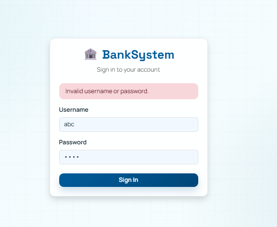</p>

---

## 7. Page-Level Documentation

## 7.1 Hero Page

- File: `src/pages/Hero.jsx`
- Styles: `src/pages/Hero.css`
- Route: `/`
- Access: Public
- Purpose: Marketing/entry gateway and session continuation

### Key Features

- CTA to login screen
- Continue-session routing based on stored role
- Animated visual hero with stat cards

### State and Logic

- Reads `role` from session storage
- `handleContinue` routes to role-specific destination


### Output :

<p align="center">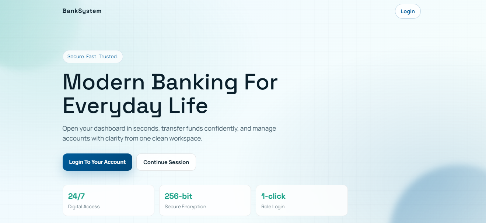</p>

## 7.2 Login Page

- File: `src/pages/Login.jsx`
- Route: `/login`
- Access: Public
- Purpose: Authenticate and bootstrap user session

### Key Features

- Username/password form
- Loading indicator during auth request
- Error banner for invalid credentials
- Post-login role routing

### State and Logic

- `username`, `password`, `error`, `loading`
- Stores backend response fields in session:
  - `role`
  - `name` (from `username` response property)
  - `referenceId`

### API Dependencies

- `loginUser` from `authApi`

### Output :

<p align="center">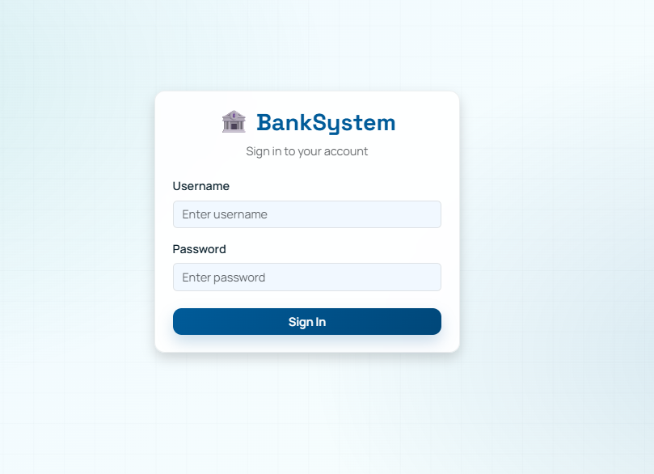</p>

## 7.3 Admin Dashboard Page

- File: `src/pages/AdminDashboard.jsx`
- Route: `/admin/dashboard`
- Access: ADMIN only
- Purpose: Administrative control center for branches and employees

### Tabs

- Branches
- Employees

### Key Features

- Summary metrics cards (customers/accounts/branches/employees)
- CRUD for branch entities (create, update, delete)
- Employee creation and listing


### API Dependencies

- Reports: `getSummary`
- Branches: `getAllBranches`, `createBranch`, `updateBranch`, `deleteBranch`
- Employees: `getAllEmployees`, `createEmployee`

### Output :

<p align="center">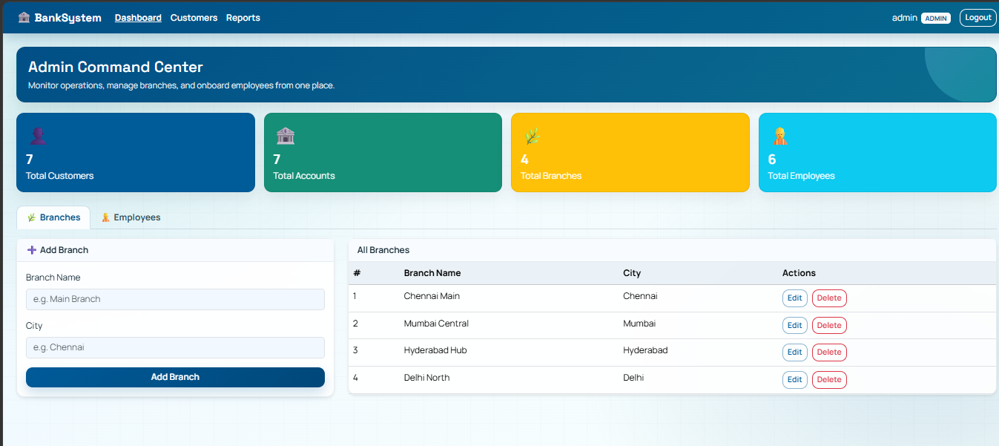</p>
<p align="center">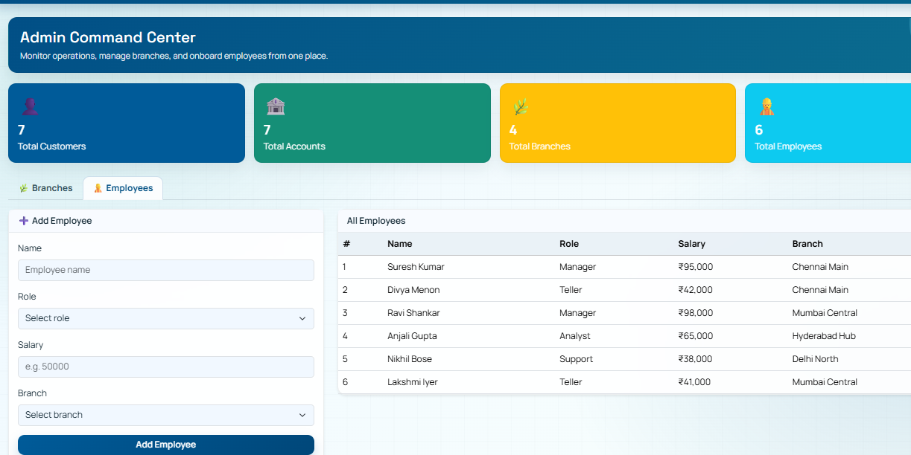</p>

## 7.4 Manage Customers Page

- File: `src/pages/ManageCustomers.jsx`
- Route: `/manage/customers`
- Access: ADMIN, EMPLOYEE
- Purpose: Customer data management and linked account administration

### Tabs and Modes

- Customers list tab
- Add/Edit customer tab
- Account management modal per customer

### Key Features

- Customer CRUD operations
- Per-customer account CRUD operations in modal
- Branch selection while account creation/editing

### State and Logic

- Customer list + form + editing state
- Account list + form + editing state
- Selected customer context for modal
- Role-aware banner content

### API Dependencies

- Customers: `getAllCustomers`, `createCustomer`, `updateCustomer`, `deleteCustomer`
- Accounts: `getAccountsByCustomer`, `createAccount`, `updateAccount`, `deleteAccount`
- Branches: `getAllBranches`

### Output :

<p align="center">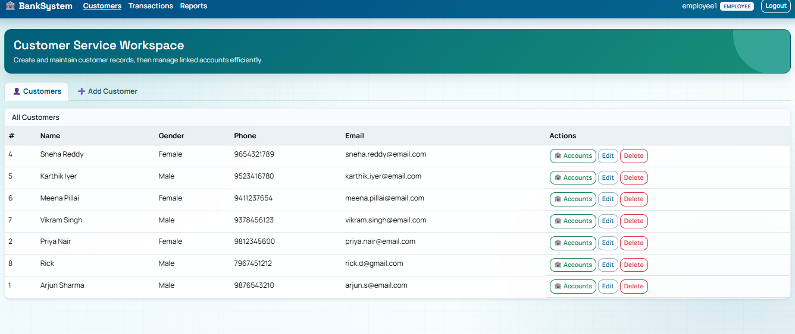</p>
<p align="center">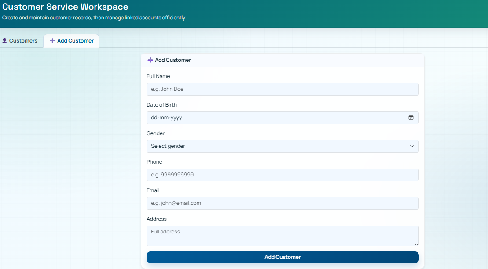</p>
<p align="center"></p>

## 7.5 Process Transaction Page

- File: `src/pages/ProcessTransaction.jsx`
- Route: `/employee/transactions`
- Access: EMPLOYEE only
- Purpose: Teller workflow for account lookup and credit/debit processing

### Workflow

1. Search account by account ID
2. Load account details and recent transactions
3. Perform credit/debit transaction
4. Refresh account state and transaction history

### Key Features

- Transaction validation (`amount > 0`, sufficient funds for debit)
- Success/error feedback banners
- Recent transaction table

### State and Logic

- Account search states (`accountId`, `accountInfo`, errors)
- Transaction form states (`txnType`, `amount`, loading, success/error)
- Transactions array

### API Dependencies

- Accounts read: direct GET via `axiosInstance` (`/accounts/{id}`)
- Transactions read/write: `getTransactionsByAccount`, `createTransaction`

### Output :

<p align="center">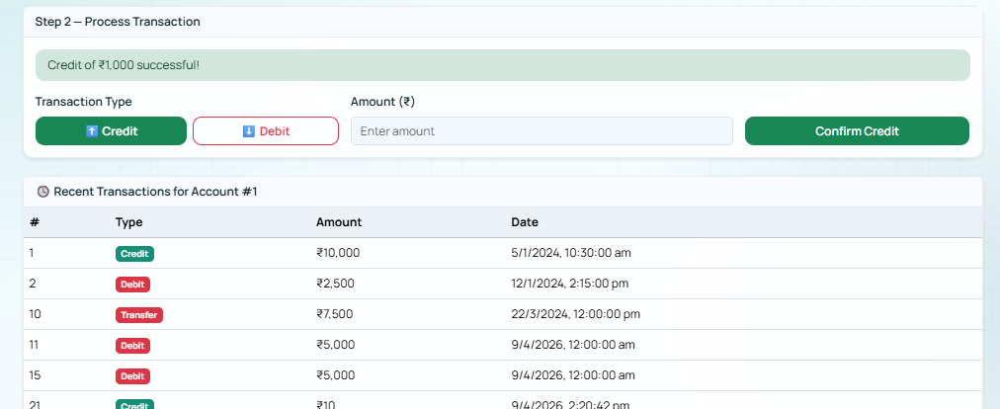</p>
<p align="center">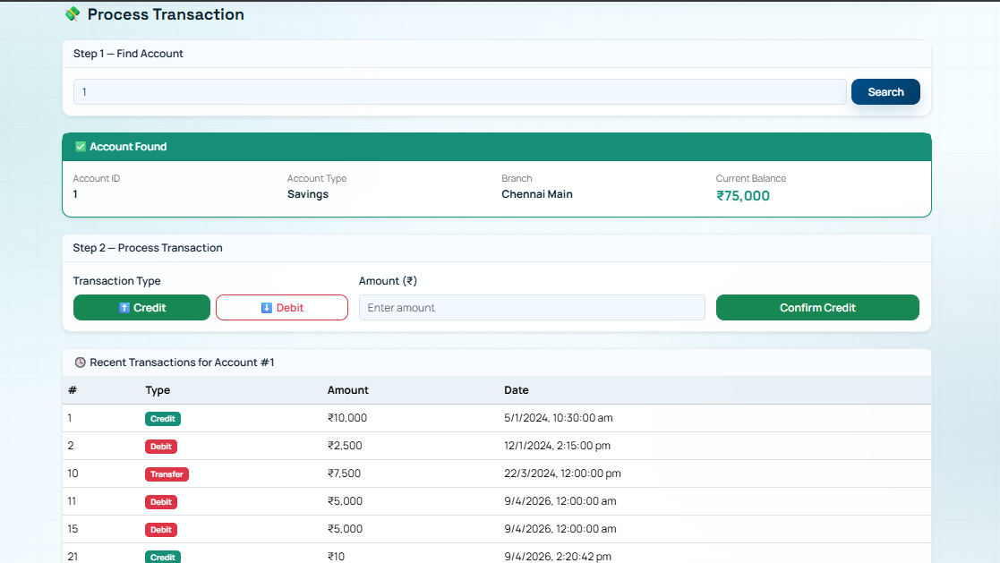</p>

## 7.6 Reports Page

- File: `src/pages/Reports.jsx`
- Route: `/reports`
- Access: ADMIN, EMPLOYEE
- Purpose: Consolidated operational analytics and loan visibility

### Tabs

- Branch Summary
- Recent Transactions
- Loans

### Key Features

- KPI cards for business overview
- Branch-wise aggregation table
- Last transactions table
- Loan type distribution summary and full loan list


### API Dependencies

- Reporting: `getSummary`, `getBranchSummary`, `getRecentTransactions`
- Loans: `getAllLoans`

### Output :

<p align="center">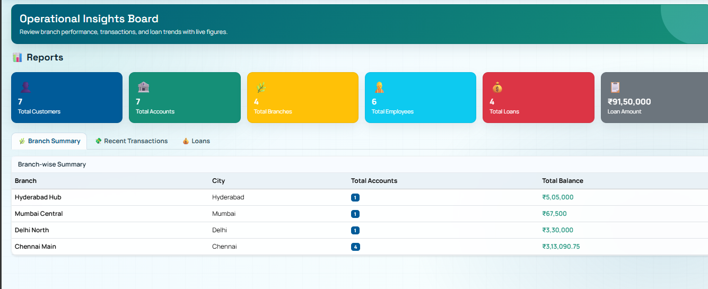</p>
<p align="center">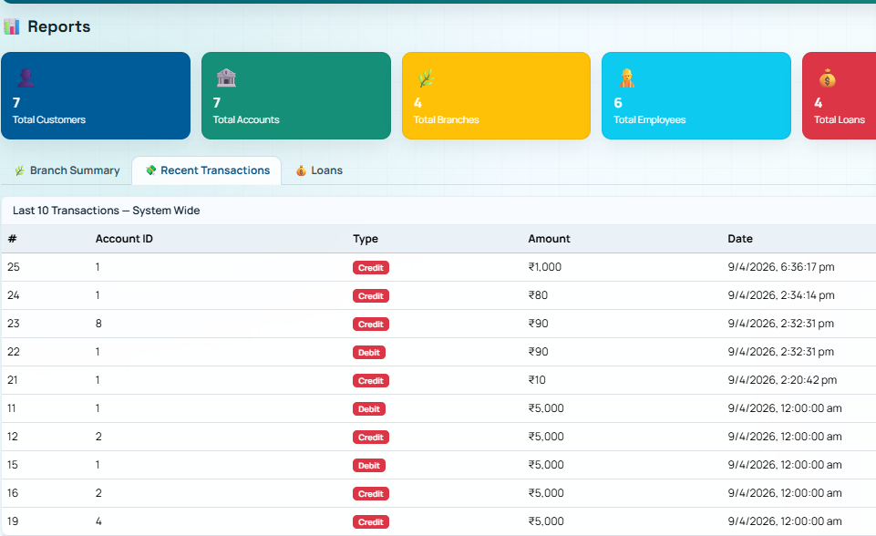</p>
<p align="center">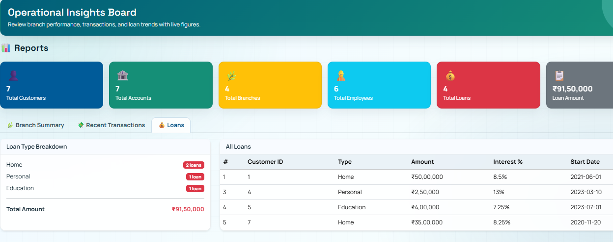</p>

## 7.7 Customer Portal Page

- File: `src/pages/CustomerPortal.jsx`
- Route: `/customer/portal`
- Access: CUSTOMER only
- Purpose: End-user self-service for account overview, transfers, and account activity

### Tabs

- My Accounts
- Transfer Money
- Transactions 

### Key Features

- Displays all accounts for logged-in customer (`referenceId`)
- Internal transfer via paired debit/credit transaction creation
- Account-level transaction history viewing

### Transfer Logic Notes

- Validates source account selection
- Prevents same source/target account
- Validates positive amount and sufficient source balance
- Verifies target account existence via account lookup endpoint

### API Dependencies

- Accounts: `getAccountsByCustomer`, direct GET via `axiosInstance` for target validation
- Transactions: `createTransaction`, `getTransactionsByAccount`

### Output :

<p align="center">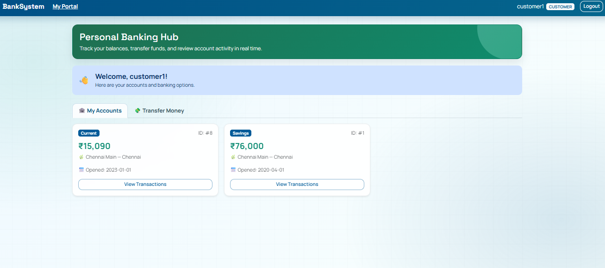</p>
<p align="center">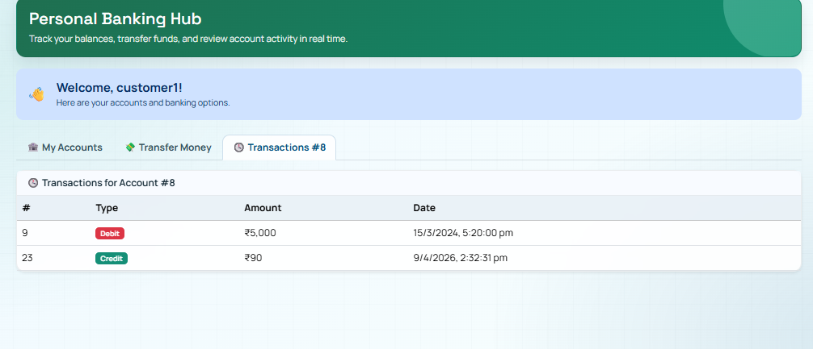</p>
<p align="center">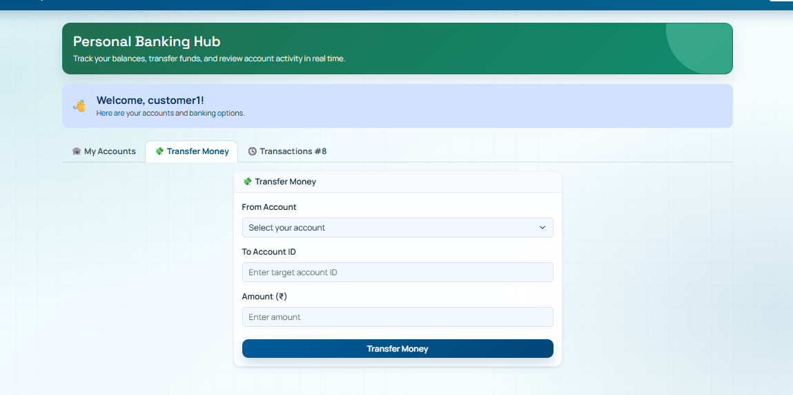</p>

---

## 8. API Layer Documentation

All API modules are thin wrappers around a shared Axios instance.

## 8.1 axiosInstance

- File: `src/api/axiosInstance.js`
- Base URL: `http://localhost:8080/api`
- Behavior:
  - Logs requests in development mode
  - On 401/403: clear session and redirect login
  - On 500: logs backend error marker

## 8.2 authApi

- File: `src/api/authApi.js`
- Endpoints:
  - `POST /auth/login`

## 8.3 customerApi

- File: `src/api/customerApi.js`
- Endpoints:
  - `GET /customers`
  - `POST /customers`
  - `PUT /customers/{id}`
  - `DELETE /customers/{id}`

## 8.4 accountApi

- File: `src/api/accountApi.js`
- Endpoints:
  - `GET /accounts`
  - `GET /accounts/customer/{customerId}`
  - `POST /accounts`
  - `PUT /accounts/{id}`
  - `DELETE /accounts/{id}`

## 8.5 branchApi

- File: `src/api/branchApi.js`
- Endpoints:
  - `GET /branches`
  - `POST /branches`
  - `PUT /branches/{id}`
  - `DELETE /branches/{id}`

## 8.6 employeeApi

- File: `src/api/employeeApi.js`
- Endpoints:
  - `GET /employees`
  - `POST /employees`

## 8.7 loanApi

- File: `src/api/loanApi.js`
- Endpoints:
  - `GET /loans`
  - `GET /loans/customer/{customerId}`
  - `POST /loans`

## 8.8 paymentApi

- File: `src/api/paymentApi.js`
- Endpoints:
  - `GET /payments`
  - `GET /payments/account/{accountId}`
  - `POST /payments`

## 8.9 reportApi

- File: `src/api/reportApi.js`
- Endpoints:
  - `GET /reports/summary`
  - `GET /reports/branch-summary`
  - `GET /reports/transactions/recent`

## 8.10 transactionApi

- File: `src/api/transactionApi.js`
- Endpoints:
  - `GET /transactions/account/{accountId}`
  - `POST /transactions`

---

## 9. Styling System Documentation

## 9.1 Global Theme

- File: `src/theme.css`
- Role: Application-wide visual identity, Bootstrap token overrides, surface styling, component refinements

### Highlights

- Custom color tokens via CSS variables
- Google fonts (`Space Grotesk`, `Manrope`)
- Gradient/background layers and subtle grid overlay
- Themed role banners (`admin`, `employee`, `customer`)
- Unified card, button, tab, table, modal styling

## 9.2 Hero Theme

- File: `src/pages/Hero.css`
- Role: Landing page visual system

### Highlights

- Hero-specific tokens
- Animated floating gradient orbs and reveal animation
- Responsive typography and CTA layout adaptation


---

## 10. State Management Strategy

Current strategy relies on local component state + browser session storage.

- Local UI/Data state: React `useState`
- Data fetch lifecycle: React `useEffect`
- Session state: `sessionStorage`

Session keys in use:

- `role`: authorization and conditional navigation
- `name`: display identity in navbar and greetings
- `referenceId`: customer-scoped resource lookup

This approach is simple and effective for medium-size applications, but should be monitored as complexity grows.

---

## 12. Conclusion

The frontend is a practical, role-aware banking UI foundation with clear functional segmentation by user role. Its current architecture supports iterative growth and backend integration effectively. The strongest immediate gains will come from typed contracts, test automation, and stronger API consistency patterns.
